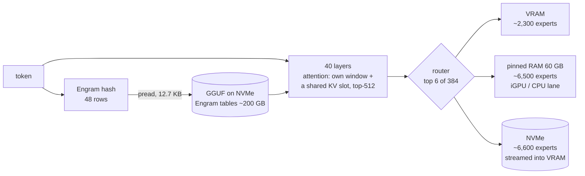

# DeepSeek V4.1 Flash (1017) on Abyss

From v1.3.29 Abyss runs [DeepSeek-V4.1-Flash-1017](https://huggingface.co/deepseek-ai/DeepSeek-V4.1-Flash-1017)
(revision `1bae0e10`) on the same fast path as DeepSeek V4: one GPU, the RAM tier (computed by the CPU or an APU's
iGPU), and the SSD for the experts that fit neither. This page is for running it; the forward pass and every change
against V4 are in [SPEC.md](SPEC.md).

## What is different from V4

| | DeepSeek V4 Flash (0731) | DeepSeek V4.1 Flash (1017) |
| --- | --- | --- |
| Layers / hidden / experts | 43 / 4096 / 256 (top 6) | 40 / 5120 / **384** (top 6), expert width 2304 |
| Compressed attention | every compressed layer has its own compressor (CSA ratio 4 / HCA ratio 128) and, on CSA, its own indexer | **four shared KV slots** written by layers 2 / 8 / 14 / 20 (ratio 2 or 1); 8 index sources pick the top-512 and the layers between reuse it |
| Long contexts | indexer top-512 | + **candidate blocks** from layer 20 past 16K tokens |
| Hyper-connections | the sublayer's own `pre` | `pre` **lags one sublayer**; no `output_hc_*` head |
| Router | layers 0-2 hash-routed | biased top-6 on every layer |
| Engram | - | **two hashed n-gram tables (~101 GB each)** added before layers 1 and 14: 48 rows of 264 bytes a token, read row by row from the GGUF |
| Expert bytes (Q2-class GGUF) | ~93 GB (UD-Q2_K_XL): all fit VRAM + RAM on a 94 GB box | 153 GB (nazeshinjite Q2): **~43% stay on the SSD** |
| Chat | V4 template | `<｜System｜>`, DSML tags with a leading space; the ds4-layout GGUFs mark the chat tokens as normal (handled from v1.3.30) |

What this means for speed: V4 keeps every expert in VRAM + RAM, so its decode is bound by the GPU and the iGPU lane
(~92-95 tok/s). V4.1 reads experts from the SSD (10 MB each, ~3-4 ms at 3.4 GB/s), and how many a token decides the
speed: 13-15 ms a token when it is near zero, ~28 ms past 1.5 a token. A faster NVMe is the cheapest lever on one GPU.



(The counts are the RTX 5090 + 94 GB box with nazeshinjite's Q2 and a 60 GB RAM tier.)

## GGUFs that load

The packer (`tools/iq_pack.py`) reads both V4.1 layouts:

| GGUF | layout | experts | notes |
| --- | --- | --- | --- |
| [nazeshinjite/DeepSeek-V4.1-Flash-1017-ds4-GGUF](https://huggingface.co/nazeshinjite/DeepSeek-V4.1-Flash-1017-ds4-GGUF) `Q2` | ds4 (antirez) | IQ2_XXS gate/up, Q2_K down, 1017 imatrix (9.95 MB an expert) | Q8_0 dense, FP8 Engram. **The fast one.** 366 GB |
| [mrfakename/DeepSeek-V4.1-Flash-1017-GGUF](https://huggingface.co/mrfakename/DeepSeek-V4.1-Flash-1017-GGUF) `Q2_K` | llama.cpp PR | Q2_K gate/up, Q3_K down (12.8 MB) | dense and Engram tables are Q2_K too - low quality alone (teacher KL 0.64) |

The `deepseek41` GGUFs from kyuz0 / antirez named "v4.1" without `1017` are the September checkpoint
(`general.source.revision` `df42c109`); check the revision before trusting a repo name. Lucebox's ROCMFP files use
their own expert types (107 / 104), which Abyss does not read; their dense tensors and Engram tables do (a hybrid,
below).

```sh
.venv/bin/python tools/iq_pack.py --gguf <DeepSeek-V4.1-Flash-1017-Q2.gguf> --out <dir>/pack --compat-bf16
```

The pack keeps only an index, ~2.5 GB of converted small tensors and the Engram table offsets; the experts and the
Engram rows are read from the GGUF. Copy the 1017 chat template (`tokenizer/chat_template.jinja` from a GGUF that has
one, e.g. mrfakename's) into the pack if the GGUF carries none - the ds4-layout files do not. Keep the GGUF on a fast
local NVMe: the experts that do not fit and every Engram row come from it.

## Running it

`./setup-deepseek.sh` installs DeepSeek V4 only. For V4.1, build the engine (the manual's
[Build](../MANUAL.md#build)), make the pack as above and write the config next to the others (`abyss-<name>.json`):

```json
{
 "exe": "<Abyss>/build/strata",
 "args": ["--glm-pack", "<dir>/pack", "--max-context", "65536", "--prefill", "auto"],
 "cwd": "<Abyss>",
 "tokenizer": "<dir>/pack/tokenizer",
 "model_name": "deepseek-v4.1-flash-1017-q2",
 "gpu": [0],
 "sampling": {"temperature": 1.0, "top_p": 0.95},
 "port": 8082,
 "log": "<Abyss>/abyss-dsv41-q2.log",
 "env": {"STRATA_GLM_RAM_GB": "60", "STRATA_GLM_DISK_READERS": "8", "STRATA_GLM_USAGE": "0",
         "STRATA_GLM_TAIL_SKIP": "3", "STRATA_GLM_TAIL_SKIP_DISK": "1"}
}
```

Then start the server in a memory-capped scope. 153 GB of experts on a 94 GB box keep the page cache full, and without
a cap systemd-oomd may kill the session that started the server:

```sh
systemd-run --user --scope -p MemoryMax=88G .venv/bin/python serve/server.py --engine strata \
  --config abyss-dsv41-q2.json --port 8082
```

Drop the two `TAIL_SKIP` entries for the exact routing (17.7 tok/s instead of ~28, below). Do not add
`ManagedOOMPreference=omit` to the scope: oomd then kills other programs instead.

### A lighter dense pack (Q5_K)

Every token reads all 8.14 GB of the dense weights, and 4.65 GiB of that is three Q8_0 tensors a layer: `attn_q_b`,
`attn_output_a` and `attn_output_b`. As for DeepSeek V4 ([the manual](../MANUAL.md#a-lighter-dense-pack-the-attention-projections-at-q6_k-or-q5_k)),
`tools/requant_dense.py` re-quantizes just those to Q5_K (3.01 GiB) and copies every other byte; from v1.3.36 it keeps
the GGUF's 16 KB alignment (before, the V4.1 output came out shifted and `iq_pack.py` refused it). The new GGUF is
another 366 GB (~25 minutes); the pack takes its expert statistics and tokenizer from the original one:

```sh
M=<models dir>
GGUF_PY=~/llm/apps/llama.cpp/gguf-py LIBGGML=~/llm/apps/llama.cpp/build-cuda/bin/libggml-base.so \
  .venv/bin/python -I tools/requant_dense.py $M/nazeshinjite/DeepSeek-V4.1-Flash-1017-Q2.gguf \
  $M/nazeshinjite-attn-q5k q5_k 'blk\.\d+\.attn_q_b\.weight' 'blk\.\d+\.attn_output_[ab]\.weight'
.venv/bin/python tools/iq_pack.py --gguf $M/nazeshinjite-attn-q5k/DeepSeek-V4.1-Flash-1017-Q2.gguf \
  --out $M/nazeshinjite-attn-q5k/pack --compat-bf16
cp -r $M/nazeshinjite/pack/{expert_prior.txt,expert_counts.txt,tokenizer} $M/nazeshinjite-attn-q5k/pack/
```

Then point the config's `--glm-pack` and `tokenizer` at `nazeshinjite-attn-q5k/pack`. On the 8 held-out sequences
(the speed config above, v1.3.36): KL 0.2416 -> 0.2508, top-1 78.96 -> 78.48%, ppl 9.78 -> 9.88, and 10-15% faster
a sequence where the SSD had no slow spell (seq 0 / 1 / 2 / 4 / 5: 36.6 / 36.7 / 29.3 / 29.5 / 29.0 ->
31.4 / 31.2 / 26.6 / 26.2 / 26.1 ms a token); the dense weights drop to 6.50 GB and the VRAM tier gains 177 expert
slots (2,321 -> 2,498). It stays optional until a swe-bench run shows the answers hold up.

## Quality and speed (RTX 5090 + Radeon 8060S lane + 94 GB RAM + NVMe at 3.4 GB/s)

Quality is measured against the unquantized 1017's top-256 log-probs on Lucebox's 8 held-out sequences
(8 x 1,023 positions, `eval/` of [Lucebox/DeepSeek-V4.1-Flash-1017-ROCMFP-GGUF](https://huggingface.co/Lucebox/DeepSeek-V4.1-Flash-1017-ROCMFP-GGUF)):

| | decode | KL | top-1 agreement | ppl |
| --- | --- | --- | --- | --- |
| nazeshinjite Q2 + disk tail skip (the config above, v1.3.31) | 35.9 ms/token (27.9 tok/s); 29-37 ms on 7 of the 8 | 0.241 | 78.9% | 9.75 |
| nazeshinjite Q2, exact routing (v1.3.29) | 56.6 ms/token (17.7 tok/s) | 0.229 | 79.2% | 9.69 |
| hybrid: Lucebox Q8_0 dense + 8-bit Engram, mrfakename Q2_K/Q3_K experts | 118 ms/token (8.5 tok/s) | 0.168 | 83.4% | 9.25 |
| (Lucebox ROCMFP2S-IM1017, their numbers) | - | 0.253 | 78.7% | 9.78 |

swe-bench with the config above (v1.3.31, 60 tasks x 5): of the first 35 tasks it resolved 34 (quality 84.9;
DeepSeek V4 Flash 35 and 85.0) at **51.6 tok/s** end to end, 38-59 a task (V4 Flash on the same 35 tasks: 107.2).
The engine averaged 19.1 ms a token over those 175 answers: 15.3 ms where it read under 0.5 experts a token from the
SSD, 28.2 ms past 1.5. The run is valid only up to task 35, where a 15K-token reasoning hit the 16K bug fixed in
v1.3.32; a full re-run is pending. On the 16 long tasks of the L7 set it resolved 14 at 28.9 tok/s.

On the same GGUF Abyss matches llama.cpp's V4.1 pull request (teacher KL 0.639 against 0.636). The prompt path
(batched MoE, the attention a token at a time) agrees with the token path at KL 0.013; a chat's next turn reuses the
previous state (1,132-token turn: 44 s -> 4.7 s of prompt, identical text). Prompts are slow: on the hybrid pack a
1K-token prompt took ~27 s with 8 SSD readers, most of it reading the experts the prompt touches.

Two things make single numbers noisy here: this NVMe has slow spells (one run in eight at 2x the read waits, and it
reads slower once warm), and before v1.3.31 the iGPU lane stalled for 15-24 s now and then. Compare runs by their
disk waits (`STRATA_GLM_TIMING=1`, the `tiers` line), not by one mean.

The hybrid shard set is shard 1 = the dense and Engram tensors fetched from Lucebox's GGUF by HTTP range, shards
2..11 = symlinks to mrfakename's shards, packed with `iq_pack.py --first-wins`.

## Options for this model

| variable | effect |
| --- | --- |
| `STRATA_GLM_TAIL_SKIP=3 STRATA_GLM_TAIL_SKIP_DISK=1` | leave out a route's 4th-6th experts when they are only on disk: 56.6 -> 34.2 ms/token, KL 0.229 -> 0.240, top-1 79.2 -> 78.9% (lossy, off by default; `=4` keeps ranks 1-4: 43.9 ms, KL 0.235) |
| `STRATA_GLM_RAM_GB=60` | the RAM tier; on a 94 GB box keep ~25 GB for the page cache (the SSD experts and the Engram rows go through it) |
| `STRATA_GLM_DISK_READERS=8` | eight SSD readers for a prompt's experts (hybrid pack, 1K-token prompt: 33 -> 27 s) |
| `STRATA_GLM_USAGE=0` | no usage file: a short session's counts froze the tiers (137 -> 169 ms/token) |
| `STRATA_GLM_RAM_THP` | on (v1.3.31): the RAM tier in transparent huge pages; with 4 KB pages the APU driver re-validated them for 15-24 s at a time |
| `STRATA_GLM_STREAM_FETCH` | on (v1.3.31): a disk-landed expert goes to VRAM chunk by chunk while the SSD still reads it (seq 0: 43.6 -> 39.5 ms/token, same logits) |
| `STRATA_DS41_ENGRAM_CACHE_MB` / `_THREADS` | the Engram raw-row cache (default 256 MB) and read threads (default 15 + caller) |
| `STRATA_GLM_DISK_LANE=1` | a disk read is computed by the CPU / iGPU lane from its RAM landing instead of being pulled into VRAM (-5% on the Q2_K/Q3_K experts; none on the Q2) |
| `STRATA_DS41_ENGRAM_ASYNC` | on (v1.3.36): a token's 48 Engram rows are read by a background thread while layer 0 runs; layers 1 and 14 wait for them on the GPU and copy them host-mapped (-0.5 ms a token, same logits) |
| `STRATA_DS41_ENGRAM_PREFETCH` | 8 (v1.3.36): threads reading a prompt chunk's table 0 then table 1 rows into the row cache right after its hash (1K-token prompt: Engram 1.7-1.9 -> 0.6 s, row-cache hits 8 -> 79%, the prompt -6-7%); `0` off |
| `STRATA_GLM_IGPU_EARLY` | on (v1.3.36): the iGPU lane starts before a route's SSD reads instead of after them (-2%, same logits) |

Measured and left off: `STRATA_GLM_AHEAD` (the predicted reads were 22% useful and crowded the SSD; v1.3.36 lets a
demand read wait on an in-flight lookahead read inside the streamed fetch, `STRATA_GLM_AHEAD_MERGE`, which saves 2%,
but with a 3.4 GB/s SSD 37.4 ms a token still loses to 34.9 without lookahead - to be re-measured on a faster NVMe),
`STRATA_GLM_SEED_PRIOR=1` and `STRATA_GLM_DEMOTE_TIES=1` (46.8 -> 48.5 / 46.1 ms with more RAM re-reads),
`STRATA_GLM_DISK_ADAPT=1`, `STRATA_GLM_DEFER=1` (-4% at KL 0.15 -> 0.28 on one sequence).

## Not yet for V4.1

Speculative decoding / the verify window (the 1017 FP8 release has three MTP layers; no GGUF carries them),
conversation slots on disk, a layer split, a batched prompt attention (the prompt's attention runs a token at a time,
~5 ms a token), images, and the one-command setup.
